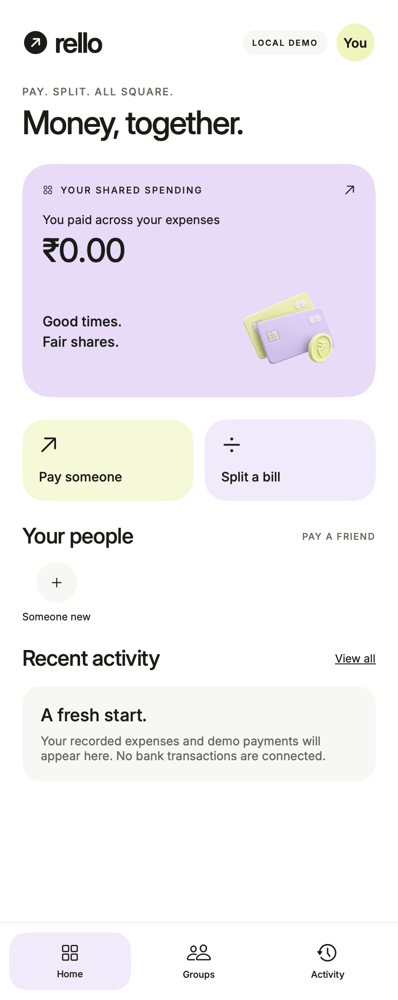

# Rello

A SwiftUI payment companion and local expense prototype. White, lavender and lime UI with bundled Inter typography.

## PWA Companion

Try Rello in iPhone Safari without Xcode:

- [PWA source repository](https://github.com/atharvamhaske/rello-pwa)
- [Open the hosted PWA](https://rello-payment-lab.cld-9-2499.chatgpt.site/) · invited-account sign-in required
- [PWA screenshots, user guide and limitations](https://github.com/atharvamhaske/rello-pwa#readme)

The PWA is maintained separately from this SwiftUI app. It supports demo payments, local expenses and an experimental Google Pay handoff. Direct bank linking and verified real-money processing are not implemented.

## UI Preview

Current SwiftUI home screen, rendered locally with empty activity. This image shows the interface, not a verified bank connection or successful payment.

## In-App Banking Goal

The intended experience is bank linking and payment authorization within Rello. This is not implemented. It requires an authorized UPI integration through a PSP bank and applicable NPCI onboarding, certification and approvals. The existing 123PAY call route below is an interim implementation, not that in-app experience. No bank partnership or production payment credentials are configured.

## Guided iPhone Payments

Pay someone now opens a guided UPI 123PAY flow using the service number 9188123123 published by [PNB](https://www.pnb.bank.in/UPI-One-Two-Three-Pay.html), checked on 24 October 2026. Support for your particular bank, SIM and recipient must be verified with the service. This is not a direct banking API integration.

1. Open `Flow.xcodeproj` in full Xcode. Select the Rello target, your Personal Team under Signing & Capabilities, and a connected physical iPhone. Follow Xcode’s device setup prompts and Run.
2. Use your bank-registered SIM with cellular service. Open Pay someone, enter the recipient’s 10-digit mobile number and amount, then review.
3. Read the linked official instructions and acknowledge that the service can transfer real money. Tap Call 123PAY and confirm the iOS phone prompt.
4. Follow the voice service to select or set up a supported bank account. Enter the recipient and amount again in the call; Rello does not send them automatically. Verify the recipient and amount before authorizing.
5. Enter bank credentials only in the official service, never in Rello. Return to Rello and choose Paid, Failed or Not sure in the attempt history.

No call or real transfer has been tested by the developer. Full Xcode is not installed in the current development environment, so the iOS-specific code still requires device compilation and validation. Mac and Simulator disable calling. The adjacent local `Rello Preview.app` supports inspecting the guide and local history; it is not included in GitHub.

## Local Payment-Attempt History

Before requesting a call, Rello atomically saves a unique attempt ID, recipient, amount and timestamp in Application Support/Rello/call-attempts.json. If saving fails, the call does not start. Corrupt history is preserved and blocks new calls.

The initial state is Awaiting confirmation. Users can record Reported paid, Reported failed or Not sure; each change appends a timestamped event. Results are labelled Reported by you, never bank-confirmed. Opening or ending a call does not prove a transfer occurred. Check bank/service history before retrying an uncertain payment to avoid duplicates.

Reopen Pay someone to see previous attempts and update their status. This history is currently separate from the home Activity tab, which holds local expenses and older demo entries. The app cannot read bank SMS, discover payments made elsewhere, or independently verify an outcome. Screenshot attachments and manual reference entry are not implemented.

History and expense recording work without internet. The phone service requires cellular connectivity; carrier charges may apply. No-network money transfer is not supported.

## Local Checks

Run `./check.sh` for amount validation, split conservation checks and native Mac compilation. On Mac, review a recipient and amount and confirm that calling is disabled. On iPhone, test cancelling the system phone prompt, returning from a call, recording Not sure, and reopening the app to verify history persistence. Do not interpret any user-reported status as bank confirmation.

Equal-split previews record local expenses. Shared groups, named-member balances, QR scanning, automatic bank linking and provider verification are not implemented.

Inter is bundled under the SIL Open Font License: `Flow/Resources/OFL.txt`. Payment artwork is AI-generated. UI inspiration includes the supplied references and Emil Kowalski’s design engineering guidance. The retained demo receipt component respects Reduce Motion; the real call flow does not display a simulated success receipt.
